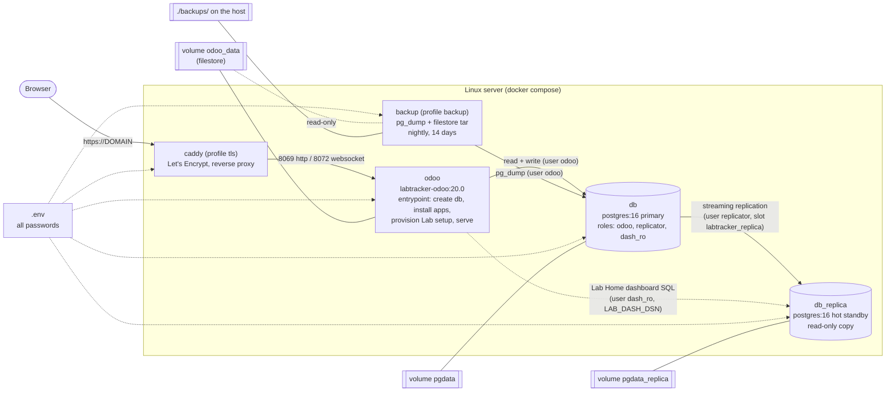
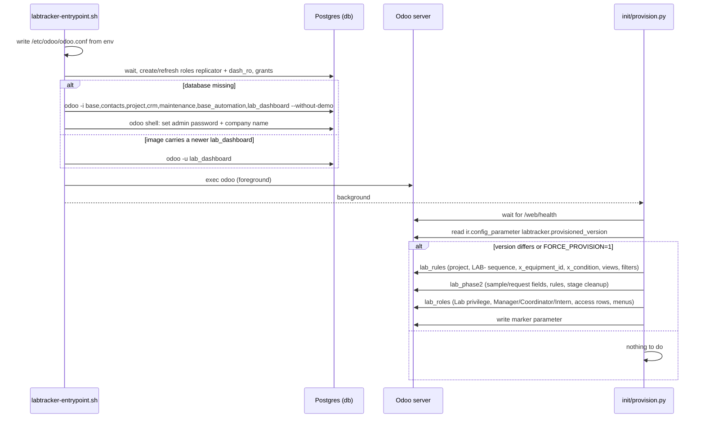

# Architecture

Five containers on one Docker Compose network. Only `caddy` (ports 80/443) is reachable from the internet;
`odoo` is bound to 127.0.0.1 on the host and the databases have no host ports at all.

## Boot sequence of the `odoo` container

## What lives where

| Thing | Location | Created by |
|-------|----------|-----------|
| Odoo database `labtracker` | volume `pgdata` | entrypoint on first boot |
| Read-only copy | volume `pgdata_replica` | `db/replica-entrypoint.sh` via `pg_basebackup -R` on first boot |
| Uploaded files (filestore) | volume `odoo_data` | Odoo |
| TLS certificates | volume `caddy_data` | Caddy |
| Backups | `./backups/` (host folder) | `backup/backup.sh` |
| Secrets | `./.env` (mode 600) | `make-env.sh` |
| Lab customisations (fields, rules, views, roles) | inside the Odoo database | `init/*.py`, idempotent, marker `labtracker.provisioned_version` |

## Security notes

- Database users: `odoo` (owner, used by Odoo and backups), `replicator` (replication only, may connect
  only from the compose network), `dash_ro` (SELECT only, read-only transactions, 15 s statement timeout).
- Odoo runs with `list_db = False` and a `dbfilter`, so the database manager is hidden; the master
  password (`ODOO_MASTER_PASSWORD`) is still required for the few manager endpoints that remain.
- Lab Home access is enforced server-side (`lab.dashboard.get_data` raises AccessError for interns), the
  menu visibility set by `lab_roles.py` is only cosmetic.
- Interns are limited by a global `ir.access` restriction on `project.task` (Odoo 20 merged record rules
  and access rights into `ir.access`), plus an automation that blocks assignee changes.
